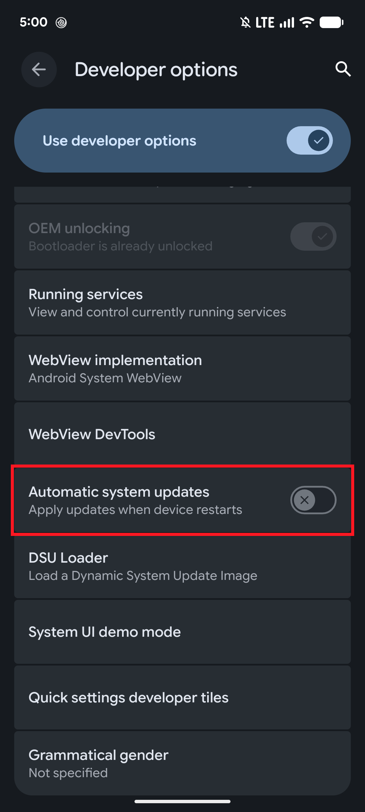
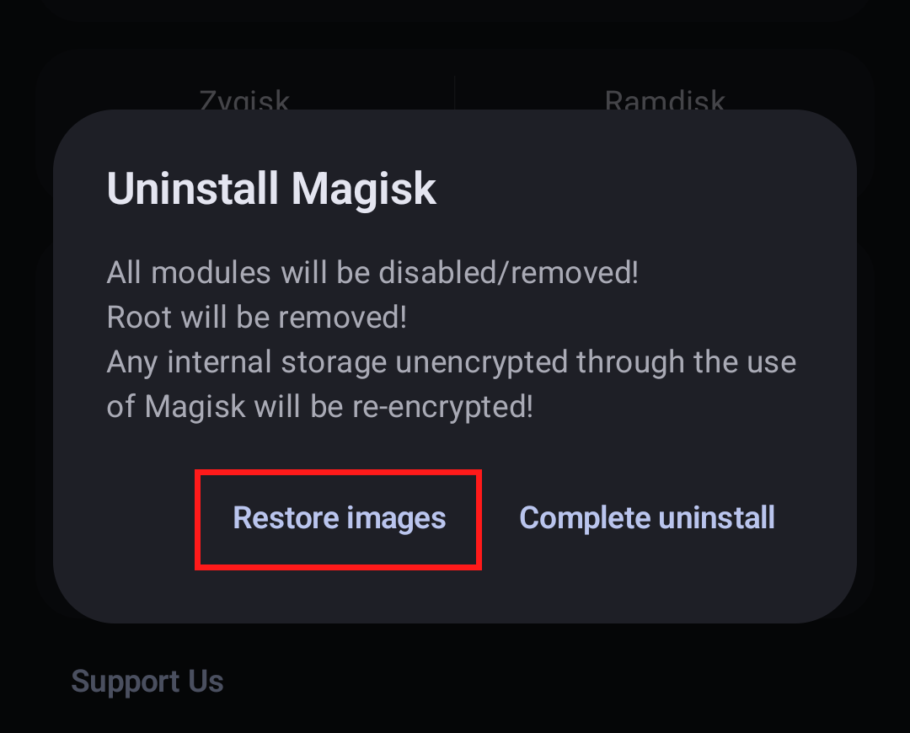
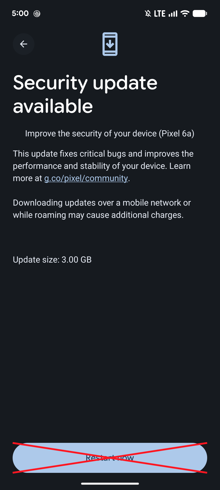
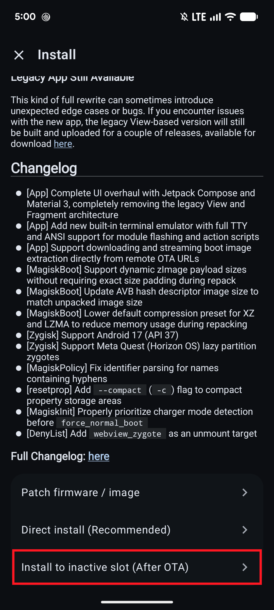
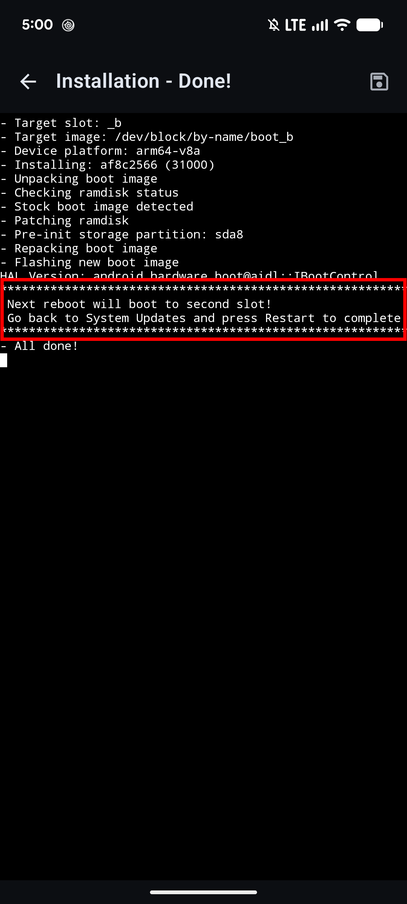
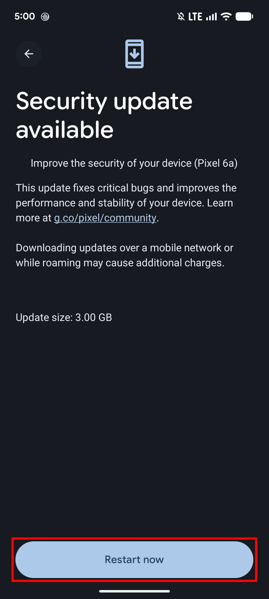

## OTA Upgrade Guides

Magisk does not modify read-only partitions by default, which makes applying official OTAs much simpler. **OTA updates are only supported on devices with A/B partitions (Seamless System Updates).** On A/B devices, the OTA is installed to the inactive slot while the system is running, allowing the Magisk app to install Magisk onto the updated partitions and preserve root across the update. The exact workflow in this document is only tested on Pixel devices, as procedures for other devices may vary.

**NOTE: In order to apply OTAs, you HAVE to make sure you haven't modified any read-only partitions yourself (such as `/system` or `/vendor`) in any way. Even remounting the partition to rw will tamper block verification!!**

### Prerequisites

- Please disable _Automatic system updates_ in developer options, so it won't install OTAs without your acknowledgement.

- When an OTA is available, first go to (Magisk app → Uninstall → Restore Images). **Do not reboot or you will have Magisk uninstalled.** This will restore partitions modified by Magisk back to stock from backups made at install in order to pass pre-OTA block verifications. **Note:** Restoring the boot image is unnecessary for Pixel devices and Googlebooks, as Google's servers will automatically serve a full OTA if any partition has been modified.

### Installing the OTA

1. Install the OTA as you normally would (Settings → System → System Update) and wait for the installation to fully complete (both "Installing system update" and "Optimizing your device"). **Do not press the "Restart now" or "Reboot" button yet!**
2. Go to the Magisk app and select (**Install → Install to Inactive Slot (After OTA)**) to install Magisk to the updated slot.

 

3. Once the Magisk installation is complete, go back to the system OTA update screen and press **Restart now** to reboot from there into the updated slot.

 

