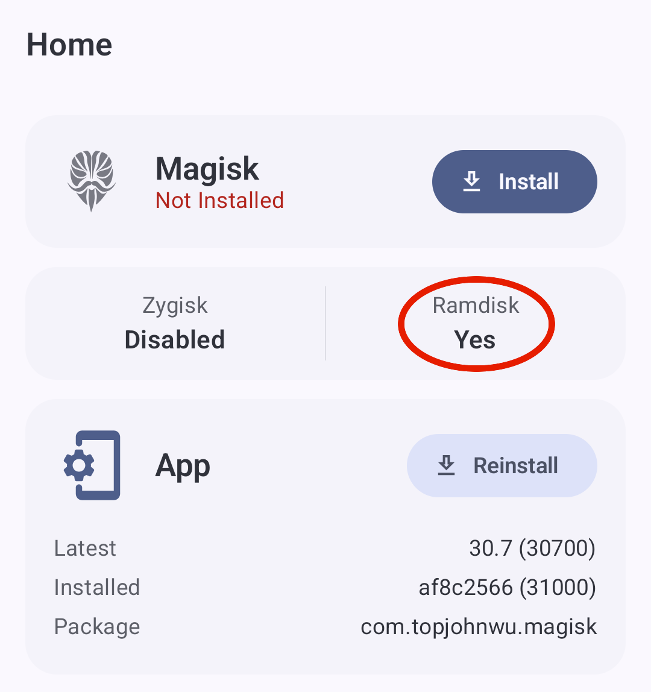

# Installation

If you already have Magisk installed, it is **strongly recommended** to upgrade directly via the Magisk app using its "Direct Install" method. The following tutorial is only for the initial installation.

## Getting Started

Before you start:

- This tutorial assumes you understand how to use `adb` and `fastboot`
- If you plan to also install custom kernels, install it after Magisk
- Your device's bootloader has to be unlocked

---

Download and install the latest [Magisk app](https://github.com/topjohnwu/Magisk/releases/latest). In the home screen, you should see:

The result of **Ramdisk** determines whether your device has ramdisk in the boot partition. If your device does not have boot ramdisk, read the [Magisk in Recovery](#magisk-in-recovery) section before continuing.

> _(Unfortunately, there are exceptions as some devices' bootloader accepts ramdisk even if it shouldn't. In this case, you will have to follow the instructions as if your device's boot partition **does** include ramdisk. There is no way to detect this, so the only way to know for sure is to actually try. Fortunately, as far as we know, only some Xiaomi devices are known to have this property, so most people can simply ignore this piece of information.)_

If you are using a Googlebook or a Samsung device, you can now jump to the [Googlebooks](#googlebooks) or [Samsung Devices](#samsung-devices) section.

If your device has boot ramdisk, you need to patch the partition image that contains the ramdisk (`boot.img`, `init_boot.img`, or `vendor_boot.img`). 
If your device does **NOT** have boot ramdisk, you need to patch `recovery.img`. 
You can either extract the raw `.img` file yourself, or provide the full official firmware package (OTA `.zip`, `payload.bin`, or factory image `.zip`), or even a direct HTTPS link to it and let the Magisk app extract the target image automatically.

Quick recap, at this point, you should have known and prepared:

1. Whether your device has boot ramdisk
2. A firmware package (or extracted `boot.img`, `init_boot.img`, `vendor_boot.img`, or `recovery.img`) based on (1)

Let's continue to [Patching Images](#patching-images).

## Patching Images

1. Press the **Install** button in the Magisk card
2. If you are patching a recovery image, check the **"Recovery Mode"** option
3. Choose **"Patch firmware / image"** in method, then select how to provide the source image:
   - **Select from storage**: Select a raw `.img` (`boot.img`, `init_boot.img`, `vendor_boot.img`, `recovery.img`), an OTA `.zip` / `payload.bin`, or a factory image `.zip`
   - **Enter image URL**: Paste a direct HTTPS URL to a remote OTA `.zip`, factory image `.zip`, or `.img` file to stream and extract the target image on the fly without downloading the full archive first
   - **Download latest Pixel factory image** _(Pixel devices only)_: Automatically fetch and extract the image matching your current Pixel build from Google's servers
4. Start the installation, and copy the patched image to your PC using ADB: 
   `adb pull /sdcard/Download/magisk_patched-[version]_[random_strings].img`
5. Flash the patched boot/init_boot/vendor_boot/recovery image to your device; 
   for most devices, reboot into fastboot mode and flash with command: 
   `fastboot flash boot /path/to/magisk_patched-[version]_[random_strings].img` or  
   `fastboot flash init_boot /path/to/magisk_patched-[version]_[random_strings].img` or  
   `fastboot flash vendor_boot /path/to/magisk_patched-[version]_[random_strings].img` or  
   `fastboot flash recovery /path/to/magisk_patched-[version]_[random_strings].img`  
6. (Optional) If your device has a separate `vbmeta` partition, you can patch the `vbmeta` partition with command: 
   `fastboot flash vbmeta --disable-verity --disable-verification vbmeta.img` (note that it may **wipe your data**)
7. Reboot and launch Magisk app (if you have wiped your data, install the Magisk APK again first), and you will see a prompt asking for environment fix; click and wait for the reboot
8. Voila!

> Warning: **NEVER** flash patched image shared by others or patch image on another device even if they have the same device model! You may need to do a full data wipe to recover your device. **ALWAYS** patch boot image **on the same device where you want to install Magisk**.

## Uninstallation

The easiest way to uninstall Magisk is directly through the Magisk app. If you insist on using custom recoveries, rename the Magisk APK to `uninstall.zip` and flash it like any other ordinary flashable zip.

## Magisk in Recovery

In the case when your device does not have ramdisk in boot images, Magisk has no choice but to hijack the recovery partition. For these devices, you will have to **reboot to recovery** every time you want Magisk enabled.

When Magisk hijacks the recovery, there is a special mechanism to allow you to _actually_ boot into recovery mode. Each device model has its own key combo to boot into recovery, as an example for Galaxy S10 it is (Power + Bixby + Volume Up). A quick search online should easily get you this info. As soon as you press the key combo and the device vibrates with a splash screen, release all buttons to boot into Magisk. If you decide to boot into the actual recovery mode, **long press volume up until you see the recovery screen**.

As a summary, after installing Magisk in recovery **(starting from power off)**:

- **(Power up normally) → (System with NO Magisk)**
- **(Recovery Key Combo) → (Splash screen) → (Release all buttons) → (System with Magisk)**
- **(Recovery Key Combo) → (Splash screen) → (Long press volume up) → (Recovery Mode)**

(Note: You **CANNOT** use custom recoveries to install or upgrade Magisk in this case!!)

## Googlebooks

1. Follow the official [bootloader unlock instructions](https://support.google.com/googlebook/answer/17389679) to unlock your Googlebook's bootloader.
2. Download and install the latest [Magisk app](https://github.com/topjohnwu/Magisk/releases/latest), press the **Install** button in the Magisk card, and choose **"Patch firmware / image"**.
3. Choose the recovery image source: either select the automatically suggested **"Download latest Googlebook recovery image"** option, or select a recovery image file manually via **"Select from storage"** / **"Enter image URL"**.
4. Under **Output destination**, you can plug in a USB flash drive to the Googlebook and select it to directly create a patched recovery media (note that all data on the selected USB drive will be erased), or choose **"Save to file"** and use the [Device Recovery Utility](https://chromewebstore.google.com/detail/chromebook-recovery-utili/pocpnlppkickgojjlmhdmidojbmbodfm) extension to flash the recovery image to a USB drive later.
5. Follow the official instructions to [boot into recovery mode](https://support.google.com/googlebook/answer/17452429#enter_recovery) and select the external / USB drive to boot.
   - **Note:** Your data will **NOT** be wiped, as Magisk automatically removes the factory reset step from the recovery image during patching.
6. The USB drive will reflash the device, and once complete, Magisk will be installed.

### System Updates

Googlebooks support seamless A/B system updates, allowing you to apply official OTA updates while preserving Magisk without reflashing from a USB drive. Follow the [OTA Upgrade Guides](ota.md) to install system updates and retain root access.

## Samsung Devices

Before proceeding, please acknowledge that:

- Installing Magisk **WILL** trip your Knox Warranty Bit, this action is not reversible in any way.
- Installing Magisk for the first time **REQUIRES** a full data wipe (this is **NOT** counting the data wipe when unlocking bootloader). Please make a backup of your data.

### Requirements

To verify whether or not Magisk can be installed in your Samsung device, you first must check the OEM Lock and KnoxGuard (RMM) status. To do so, go to `Settings` -> `Device Care` -> `Maintenance Mode` and enable it, then boot your device in Download mode with its key combo.

Possible OEM Lock values are the following:
- **ON (L)**: fully locked.
- **ON (U)**: bootloader locked, OEM unlocking enabled.
- **OFF (U)**: fully unlocked.

To unlock your bootloader, follow the instructions below. If no OEM Lock value is shown in Download mode, your device is probably not unlockable due to market limitations (USA/Canada devices).

Possible KnoxGuard values are the following:

- `Active`, `Locked`: your device has been remotely locked by your telecom operator or your insurance company.
- `Prenormal`: your device is temporarily locked, reaching 168h of uptime should trigger unlock.
- `Checking`, `Completed`, `Broken`: your device is unlocked.

Having KnoxGuard active will prevent you from installing/running Magisk regardless of your bootloader lock state.

### Unlocking the bootloader

1. Allow bootloader unlocking in **Developer options → OEM unlocking**
2. Reboot to download mode: power off your device and press the download mode key combo for your device
3. Long press volume up to unlock the bootloader. **This will wipe your data and automatically reboot.**
4. Go through the initial setup. Skip through all the steps since data will be wiped again in later steps. **Connect the device to Internet during the setup.**
5. Enable developer options, and **confirm that the OEM unlocking option exists and is grayed out.** This means KnoxGuard hasn't locked your device.
6. Your bootloader now accepts unofficial images in download mode

### Instructions

1. Use [samloader-rs](https://github.com/topjohnwu/samloader-rs) to download the latest firmware package for your device directly from Samsung servers.
2. Unzip the firmware and copy the `AP` tar file to your device. It is normally named as `AP_[device_model_sw_ver].tar.md5`
3. Press the **Install** button in the Magisk card
4. If your device does **NOT** have boot ramdisk, check the **"Recovery Mode"** option
5. Choose **"Patch firmware / image"** in method, choose **"Select from storage"**, and select the `AP` tar file
6. Start the installation, and copy the patched tar file to your PC using ADB: 
   `adb pull /sdcard/Download/magisk_patched-[version]_[random_strings].tar` 
   **DO NOT USE MTP** as it is known to corrupt large files.
7. Reboot to download mode. Use `samloader` on your PC to flash `magisk_patched-[version]_[random_strings].tar` as `AP`, together with `BL`, `CP`, and `CSC` (**NOT** `HOME_CSC` because we want to **wipe data**) from the original firmware.
8. Your device should reboot automatically once `samloader` finished flashing. **Agree to do a factory reset if asked.**
9. If your device does **NOT** have boot ramdisk, reboot to recovery now to enable Magisk (reason stated in [Magisk in Recovery](#magisk-in-recovery)).
10. Install the Magisk app you've already downloaded and launch the app. It should show a dialog asking for additional setup.
11. Let the app do its job and automatically reboot the device. Voila!

### Upgrading the OS

Once you have rooted your Samsung device, you can no longer upgrade your Android OS through OTA. To upgrade your device's OS, you have to manually download the new firmware zip file and go through the same `AP` patching process written in the previous section. **The only difference here is in the flashing step: do NOT use the `CSC` tar, but instead use the `HOME_CSC` tar as we are performing an upgrade, not the initial install**.

### Important Notes

- **Never, ever** try to restore either `boot`, `init_boot`, `recovery`, or `vbmeta` partitions back to stock! You can brick your device by doing so, and the only way to recover from this is to do a full firmware restore with data wipe.
- To upgrade your device with a new firmware, **NEVER** directly use the stock `AP` tar file with reasons mentioned above. **Always** patch `AP` in the Magisk app and use that instead.

## Custom Recovery

> **This installation method is deprecated and is maintained with minimum effort. YOU HAVE BEEN WARNED!**

Installing using custom recoveries is only possible if your device has boot ramdisk. Installing Magisk through custom recoveries on modern devices is no longer recommended. If you face any issues, please use the [Patch Image](#patching-images) method.

1. Download the Magisk APK
2. Rename the `.apk` file extension to `.zip`, for example: `Magisk-v31.0.apk` → `Magisk-v31.0.zip`. If you have trouble renaming the file extension (like on Windows), use a file manager on Android or the one included in the custom recovery to rename the file.
3. Flash the zip just like any other ordinary flashable zip.
4. Reboot and install the Magisk APK as a regular app if it is not already installed.
5. Launch the Magisk app; it will show a dialog asking for reinstallation. Do the reinstallation **directly within the app** and reboot (if you are using MTK devices that lock the boot partition after boot, please [patch the boot image](#patching-images) and flash it by custom recovery or fastboot).

> Warning: the `sepolicy.rule` files of modules may be stored on the `cache` or `metadata` partition (the pre-init partition). DO NOT WIPE THE `CACHE` OR `METADATA` PARTITION, or active module `sepolicy.rule` files will be lost until the modules are reinstalled.
